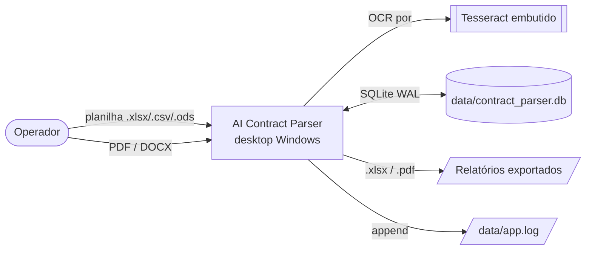

# SRS — Especificação de Requisitos de Software

| Campo | Valor |
|---|---|
| Documento | SRS — Software Requirements Specification (estrutura IEEE 830 / ISO/IEC/IEEE 29148) |
| Projeto | Leitor Inteligente de Contratos de Locação (AI Contract Parser) |
| Versão do produto | 0.2.0 |
| Versão do documento | 1.0 |
| Data | 2026-11-24 |
| Status | Rascunho para revisão |

**Documentos relacionados:** [BRD](BRD.md) · [FRD](FRD.md) · [TRD](TRD.md)

---

## 1. Introdução

### 1.1 Propósito
Especificar, de forma verificável, os requisitos do software AI Contract Parser **como
implementado na versão 0.2.0**. O público é formado por mantenedores, QA, o PM/stakeholder e
auditores fiscais ou jurídicos que precisem entender o que o sistema faz e como isso é
comprovado.

### 1.2 Escopo
O produto é uma aplicação desktop Windows, de usuário único e sem rede, que:
1. importa um portfólio de empresas;
2. lê contratos de locação PDF/DOCX (com OCR para PDF escaneado);
3. extrai campos por regras determinísticas com proveniência por campo;
4. avalia regras da Lei nº 8.245/91;
5. calcula o IRRF 2026 sobre o aluguel;
6. cruza contratos com o portfólio;
7. mantém um histórico local em SQLite;
8. exporta os relatórios em PDF e Excel.

Fica fora do escopo tudo o que está listado no BRD §9 (Docker, LLM, revalidação online da
tabela IRRF, multiusuário etc.).

### 1.3 Definições, acrônimos e glossário

| Termo | Definição |
|---|---|
| Locador / Locatário | Proprietário que aluga / quem paga o aluguel. "Locador principal" é o primeiro bloco LOCADOR rotulado (ou o narrativo). |
| PF / PJ | Pessoa Física (CPF, 11 dígitos) / Pessoa Jurídica (CNPJ, 14 dígitos). |
| CNPJ normalizado | CNPJ só com dígitos, exatamente 14 posições. |
| IRRF | Imposto de Renda Retido na Fonte. |
| Desconto simplificado | Abatimento mensal de R$ 607,20 (Lei nº 14.663/2023), aplicado à base do locador PF. |
| Redutor | Redução do imposto da Lei nº 15.270/2025 (Art. 3º-A da Lei nº 9.250/1995). |
| Memória de cálculo | Conjunto de valores intermediários e fontes que permitem refazer o cálculo do IRRF (`ResultadoIRRF`). |
| Memória de extração | Mapa campo → (origem, confiança, revisão, detalhe) gravado em cada `Contrato`. |
| `ResultadoCampo` | Saída de um extrator: `valor`, `confianca`, `origem`, `detalhe`. |
| Origem | `REGRA` (regex/heurística), `REGRA_CALCULADA` (derivado por cálculo), `LLM` (interpretador, desligado em produção), `NAO_ENCONTRADO`. |
| Revisão (manual) | Marca indicando que um campo ou contrato precisa ser conferido por uma pessoa. |
| Ausência confiante | Campo cuja ausência é o caso normal (carência, fonte do índice, locadores adicionais): valor vazio, confiança alta, sem revisão. |
| Lacuna real | Campo esperado que não foi encontrado ou é ambíguo: `NAO_ENCONTRADO` → revisão. |
| Pendência | Empresa do portfólio sem nenhum contrato correspondente. |
| Relatório 01 / 02 | Relatório de contratos (com IRRF) / resumo de conformidade do portfólio. |
| Painel | Aba da GUI que mostra o Relatório 01 a partir do histórico persistido. |
| WAL | *Write-Ahead Logging*, modo de diário do SQLite que separa leitores e escritores. |
| OCR | Reconhecimento óptico de caracteres (Tesseract, idioma `por`). |
| LGPD | Lei Geral de Proteção de Dados (Lei nº 13.709/2018). |

### 1.4 Referências
- [BRD](BRD.md), [FRD](FRD.md), [TRD](TRD.md).
- ADR-001 (stack e arquitetura), ADR-002 (MongoDB → SQLite), ADR-003 (redutor IRRF 2026), ADR-004 (desconto simplificado). Os ADRs ficam no repositório de specs do projeto (`~/.claude/specs/`), antes em `.agent/specs/`.
- `pyproject.toml`, `contract_parser.spec`, `build.bat`, `.github/workflows/ci.yml`, `README.md`, `CHANGELOG.md`.
- Lei nº 8.245/1991; Lei nº 15.191/2025; Lei nº 15.270/2025; Lei nº 14.663/2023; MAFON 2025 (código 3208).

### 1.5 Visão geral do documento
A seção 2 descreve o produto em contexto. A seção 3 traz os requisitos específicos
(interfaces, funcionais, não funcionais, dados). A seção 4 diz como cada requisito é
verificado e traz a matriz de rastreabilidade.

---

## 2. Descrição geral

### 2.1 Perspectiva do produto
Produto autônomo, sem integração com outros sistemas. Roda localmente e persiste num arquivo
SQLite. Dependências de sistema: o binário do Tesseract (embutido no `.exe`; no modo
desenvolvimento vem do sistema).

### 2.2 Funções do produto (resumo)

| Função | RFs |
|---|---|
| Gestão do portfólio de empresas | RF-01 a RF-03 |
| Ingestão de contratos e OCR | RF-04 a RF-08 |
| Extração de campos com memória de extração | RF-09 a RF-18 |
| Flags jurídicas | RF-19 |
| IRRF 2026 com memória de cálculo | RF-20 |
| Próximo reajuste calculado e recálculo | RF-21, RF-22 |
| Painel persistente, filtros, revisão, exclusão | RF-23 a RF-28 |
| Relatórios e exportação PDF/Excel | RF-29 a RF-31 |
| Conformidade de portfólio | RF-32, RF-33 |
| Verificação de ambiente | RF-34 |

### 2.3 Classes de usuários

| Classe | Uso | Competência esperada |
|---|---|---|
| Operador | Usa a GUI diariamente. | Conhece contratos de locação e noções de IRRF; não precisa saber programar. |
| Mantenedor | Roda o código, os testes e o build. | Python 3.11+, pytest, PyInstaller. |

Não há administrador, perfis nem autenticação.

### 2.4 Ambiente operacional
- **Execução (usuário final):** Windows; `ContractParser.exe` *onefile* (sem console), sem Python nem Tesseract instalados. Os dados ficam em `data/` **ao lado do `.exe`**.
- **Desenvolvimento:** Python ≥ 3.11 (CI usa 3.13), venv, `pip install -e ".[dev]"`; Tesseract com o idioma `por` instalado para o OCR real.
- **CI:** GitHub Actions `windows-latest`.

### 2.5 Restrições de projeto e implementação
- C-01: arquitetura em camadas `domain` → `application` → `infrastructure`/`presentation`; o domínio não faz IO (ver TRD).
- C-02: persistência exclusiva em SQLite (`sqlite3` da stdlib), sem ORM nem migrações versionadas.
- C-03: nenhuma chamada de rede em produção (LLM e RFB são stubs fail-secure).
- C-04: valores monetários em `Decimal`.
- C-05: GUI em CustomTkinter + `ttk.Treeview`; a lógica de apresentação fica em controllers sem Tkinter, testáveis sem display.
- C-06: bibliotecas pesadas (PyMuPDF, pytesseract, PIL, python-docx, openpyxl, reportlab) importadas dentro das funções que as usam.
- C-07: lint com `ruff` (versão fixada `>=0.17.4,<0.18`, `line-length = 100`, alvo py311).

### 2.6 Premissas e dependências
As premissas P-01 a P-05 do BRD §10 valem aqui. Dependências de terceiros: ver TRD §3.

---

## 3. Requisitos específicos

### 3.1 Interfaces externas

#### 3.1.1 Interface com o usuário (UI)

| ID | Requisito |
|---|---|
| UI-01 | Janela única com banner de status do banco e quatro abas: Empresas, Carregar Contratos, Painel de Contratos, Conformidade (FRD §2). |
| UI-02 | Toda mensagem ao usuário é em pt-BR e sem *stack trace*; erros de banco usam a mensagem padrão "Sem conexão com o banco. Verifique se o arquivo do banco de dados é acessível …". |
| UI-03 | Valores em R$ com separador de milhar "." e decimal ","; datas dd/mm/aaaa; booleanos "Sim"/"Não". |
| UI-04 | Ações destrutivas (remover empresa, excluir contrato, limpar tudo) pedem confirmação. |
| UI-05 | Tabelas mostram estado vazio explicativo ("Nenhum contrato processado ainda — vá em 'Carregar Contratos' para começar."). |
| UI-06 | A coluna "Revisão" do Painel mostra em tooltip o motivo da revisão. |
| UI-07 | A importação de empresas roda em thread de trabalho com progresso determinado e botão Cancelar; o processamento de contratos roda na thread da UI com barra indeterminada (BRD L-09). |

#### 3.1.2 Interfaces de arquivo

| ID | Arquivo | Direção | Formato / regras |
|---|---|---|---|
| IF-01 | Planilha de empresas | Entrada | `.xlsx` (primeira planilha, leitura em streaming), `.csv` (delimitador detectado: `,` `;` tab), `.ods` (aba escolhida). Colunas mínimas: CNPJ e Razão Social. |
| IF-02 | Contrato | Entrada | `.pdf` (camada nativa ou OCR) e `.docx` (parágrafos + tabelas). Outras extensões são ignoradas na pasta ou rejeitadas na seleção avulsa. |
| IF-03 | Relatório Excel | Saída | `.xlsx` com as abas "Contratos" e "Conformidade" (FRD RF-30). |
| IF-04 | Relatório PDF | Saída | A4 paisagem, 15 colunas de largura fixa (soma 785 pt) (FRD RF-31). |
| IF-05 | Banco | Entrada/saída | SQLite em `DATABASE_PATH` (padrão `data/contract_parser.db`). |
| IF-06 | Log de auditoria | Saída | Texto UTF-8, uma linha por evento: `<timestamp ISO UTC> <mensagem>`; padrão `data/app.log` (`LOG_PATH`). |
| IF-07 | Configuração | Entrada | `.env` / variáveis de ambiente (TRD §9). |

#### 3.1.3 Interfaces com o sistema operacional e software
- **Tesseract OCR:** executado como subprocesso via `pytesseract`; tessdata via `TESSDATA_PREFIX` quando embutido.
- **Diálogos nativos** de abrir/salvar arquivo e escolher pasta (Tk `filedialog`).
- **Rede:** nenhuma.

### 3.2 Requisitos funcionais
Os requisitos funcionais são os RF-01 a RF-34 do [FRD](FRD.md), cada um com entradas,
processamento, saídas, exceções e critérios de aceite. Esta SRS não os repete. A seguir, o
modelo de dados do agregado central, que é compartilhado por esses RFs.

#### 3.2.1 Modelo de dados — agregado `Contrato` (`domain/contrato.py`, pydantic v2, `extra="forbid"`)

| Campo | Tipo | Padrão | Observação |
|---|---|---|---|
| `locador` | `Parte` | vazio | Locador principal; único usado no IRRF. |
| `locadores_adicionais` | `list[Parte]` | `[]` | Demais blocos LOCADOR rotulados. |
| `locatario` | `Parte` | vazio | Chave do match de portfólio. |
| `tipo_locacao` | `residencial` \| `comercial` \| None | None | |
| `valor_aluguel` | `Decimal` \| None | None | Base do IRRF. |
| `multa_rescisoria_total` | `Decimal` \| None | None | Mt. |
| `garantias` | `list[caucao \| fianca \| seguro_fianca \| cessao_fiduciaria]` | `[]` | |
| `data_inicio_vigencia`, `data_fim_vigencia` | `date` \| None | None | Fim = "Vencimento" no relatório. |
| `prazo_meses` | `int` \| None | None | Anos convertidos ×12. |
| `dia_vencimento_mensal` | `int` \| None | None | 1–31. |
| `carencia_meses` | `int` \| None | None | |
| `reajuste` | `Reajuste` | — | `indice`, `indice_fonte`, `periodicidade_meses`, `proximo_reajuste` (ISO ou `mm/aaaa`), `automatico: bool`. |
| `despesas` | `dict[TipoDespesa, locador \| locatario \| None]` | `{}` | Tipos: iptu, condominio_ordinario, condominio_extraordinario, seguro_incendio, taxa_administracao, outras (sem regra de detecção). |
| `prorrogacao` | `Prorrogacao` | — | `automatica: bool`, `prazo_meses`. |
| `flags` | `FlagsJuridicas` | — | 5 booleanos + `alertas: list[str]`. |
| `memoria_extracao` | `dict[str, RegistroCampo]` | `{}` | `origem`, `confianca ∈ [0,1]`, `necessita_revisao`, `detalhe`. |
| *derivados* | `campos_para_revisao` (lista ordenada), `necessita_revisao` (bool) | | |

`Parte` = `tipo` (PF/PJ), `nome`, `documento` (só dígitos). Agregados relacionados:
`Empresa` (`cnpj`, `razao_social`, `aliases`, `nomes_fantasia`, `ativo`, `origem_import`,
`created_at`), `TabelaIRRF`/`Faixa`, `ResultadoIRRF` (RF-20), `LinhaContrato` (linha do
Relatório 01) e `RegistroContrato` (`id`, `arquivo_nome`, `arquivo_hash`, `processado_em`,
`contrato`, `linha`, `revisao`, `arquivo_ausente`).

### 3.3 Requisitos não funcionais

| ID | Categoria | Requisito | Verificação |
|---|---|---|---|
| RNF-01 | Privacidade / LGPD | Nenhum dado de contrato sai da máquina: não há chamada de rede no fluxo de produção; o interpretador de LLM não é injetado e o stub lança erro se usado; o revalidador RFB é stub sem rede. Mesmo no ponto de extensão, só um recorte de até 400 caracteres seria enviado. | Inspeção de `presentation/controllers.py` (composição) e `infrastructure/llm_interpreter.py`, `atualizador_rfb.py`; testes `test_stub_llm_*`, `tests/infrastructure/test_atualizador_rfb.py`. |
| RNF-02 | Privacidade / LGPD | Contratos e planilhas reais não são versionados (`.gitignore`: `data/`, `*.pdf`, `*.docx`, `*.xlsx`, `*.csv`, exceto `tests/fixtures/**`). O harness de contratos reais só roda com `CONTRATOS_REAIS_DIR` definido e nunca no CI. | Inspeção de `.gitignore` e `ci.yml`; skip em `tests/application/test_harness_contratos_reais.py`. |
| RNF-03 | Confiabilidade | Falha por arquivo, por linha de planilha ou por gravação de item não aborta o lote; cada falha aparece no resumo. | `test_erro_de_extracao_nao_aborta_lote`, `test_importar_csv_com_erros_e_duplicados`, `test_definir_contratos_falha_de_persistencia_de_um_item_nao_derruba_o_painel`. |
| RNF-04 | Confiabilidade (degradação graciosa) | A GUI abre com o banco inacessível; `check_health` e `status_conexao` nunca lançam; falhas de `sqlite3` viram `RepositoryError` e depois `ControllerError` com mensagem amigável; o histórico corrompido não derruba a abertura. | `tests/infrastructure/test_database.py::test_check_health_*`, `test_controllers.py::test_status_conexao_*`, `::test_carregar_historico_com_exception_inesperada_na_desserializacao_degrada_e_loga`. |
| RNF-05 | Corretude monetária | Dinheiro em `Decimal`, arredondamento `ROUND_HALF_UP` em 2 casas, imposto nunca negativo, base negativa rejeitada. | `tests/domain/test_irrf.py`. |
| RNF-06 | Determinismo | A mesma entrada produz a mesma saída: os extratores são funções puras; o relógio é injetado (`hoje`) e só a GUI lê `date.today()`; desempates no fuzzy seguem a ordem do portfólio; a listagem de pasta é ordenada. | `test_sem_relogio_injetado_o_calculo_fica_desligado`, `test_empate_de_score_resolve_pela_ordem_do_portfolio`, `test_atualizar_proximos_reajustes_sem_referencia_usa_hoje_do_relogio`. |
| RNF-07 | Auditabilidade | Cada campo extraído guarda origem, confiança e detalhe; cada IRRF guarda a memória de cálculo com a base legal e a URL da fonte; cada carga do histórico grava um evento em `app.log`; cada contrato persistido guarda o nome e o hash SHA-256 do arquivo e o instante do processamento (UTC). | `test_toda_extracao_registra_proveniencia_por_campo`, `test_ca03_registra_memoria_de_calculo`, `tests/infrastructure/test_audit_log.py`, `test_contrato_repository.py::test_roundtrip_*`. |
| RNF-08 | Portabilidade | Distribuição como um único `.exe` Windows com Tesseract e `por.traineddata` embutidos; o banco e o log ficam ao lado do `.exe` (copiar a pasta preserva os dados), nunca na pasta temporária do PyInstaller. | `tests/test_config.py::test_caminho_banco_padrao_modo_frozen_*`; `test_text_extractors.py::test_tesseract_embutido_*`; inspeção de `contract_parser.spec`. O build em si não é exercitado no CI. |
| RNF-09 | Concorrência | Um único usuário. Conexão SQLite com `journal_mode=WAL`, `busy_timeout=5000` ms, `foreign_keys=ON` e `check_same_thread=False` (thread de importação). Não há suporte a vários processos gravando ao mesmo tempo. | `test_database.py::test_get_connection_aplica_pragma_*`. |
| RNF-10 | Manutenibilidade | Camadas com regra de dependência (TRD §2), lint `ruff` sem avisos e suíte pytest verde no CI a cada push/PR na `main`. | `ci.yml`; execução local em 2026-11-24: `pytest -m "not integration"` → 678 aprovados, 3 *skips*, 3 desselecionados. |
| RNF-11 | Testabilidade | Domínio e controllers testáveis sem display, sem Tesseract e sem banco externo (fakes, `sqlite3 :memory:`, imports preguiçosos). Testes que exigem recurso real usam o marcador `integration`. | `tests/support/fakes.py`; `pyproject.toml` (markers). |
| RNF-12 | Usabilidade | Mensagens e rótulos em pt-BR; estado vazio; confirmação de ações destrutivas; motivo da revisão visível; filtros combináveis. | Inspeção de `views/main_window.py`; `test_controllers.py::test_adicionar_empresa_com_campos_vazios_mensagem_amigavel`, `::test_motivo_revisao_*`. A validação visual é manual. |
| RNF-13 | Segurança | Não há segredos no repositório (`.env` ignorado; `LLM_API_KEY` vazio por decisão); o CI roda com `permissions: contents: read`. Não há autenticação (premissa de usuário único local); a proteção do arquivo do banco depende das permissões do sistema operacional. | Inspeção de `.gitignore`, `.env.example`, `ci.yml`. |
| RNF-14 | Desempenho | **Não há requisito de desempenho medido nem metas de tempo.** Observação, sem valor de requisito: a suíte não-integração rodou em ~9 s localmente. O processamento de contratos é síncrono na thread da UI (BRD L-09). | Não verificado por teste de carga. |

### 3.4 Requisitos de dados — esquema SQLite

Criado por `init_schema()` com `CREATE TABLE IF NOT EXISTS` (idempotente, sem migrações).

| Tabela | Colunas | Chaves / índices | Observações |
|---|---|---|---|
| `empresas` | `cnpj TEXT`, `razao_social TEXT NOT NULL`, `aliases TEXT` (JSON, padrão `'[]'`), `nomes_fantasia TEXT` (JSON, padrão `'[]'`), `ativo INTEGER` (padrão 1), `origem_import TEXT`, `created_at TEXT NOT NULL` | PK `cnpj` (14 dígitos) | `upsert_many` usa `ON CONFLICT(cnpj) DO UPDATE`. |
| `tabela_irrf` | `vigencia TEXT`, `faixas TEXT NOT NULL` (JSON), `fonte_url`, `base_legal`, `validado INTEGER`, `validado_em TEXT` | PK `vigencia` | Repositório implementado e testado, **não usado** no fluxo de produção (BRD L-02). |
| `contratos` | `id TEXT` (UUID4), `arquivo_nome TEXT`, `arquivo_hash TEXT NOT NULL UNIQUE`, `processado_em TEXT` (ISO UTC), `revisao INTEGER`, `arquivo_ausente INTEGER`, `contrato_json TEXT` (Contrato completo), `linha_json TEXT` (LinhaContrato com a memória de IRRF) | PK `id`; UNIQUE `arquivo_hash`; índice `idx_contratos_processado_em (processado_em DESC)` | *Upsert* por hash preserva o `id` original. `arquivo_ausente` existe, mas nenhum fluxo o define como verdadeiro hoje. |

Requisitos de integridade:
- DR-01: o CNPJ é sempre gravado normalizado.
- DR-02: `Decimal` é serializado como texto (sem perda de precisão).
- DR-03: datas em ISO 8601.
- DR-04: o JSON de contrato é reidratado com `extra="forbid"`; um registro incompatível falha na desserialização e é tratado pelo RNF-04.

### 3.5 Atributos de qualidade (síntese)

| Atributo | Como é obtido |
|---|---|
| Corretude fiscal | Fórmulas conferidas contra valores de referência calculados à mão (ADR-004) e contra uma recomposição independente no próprio teste. |
| Robustez a layout | Cascata de padrões com confiança decrescente; revisão em vez de chute. |
| Rastreabilidade | Memória de extração + memória de cálculo + hash do arquivo + log. |
| Evolutividade | Protocols no domínio (repositórios, extratores, OCR, interpretador, atualizador RFB) permitem trocar a infraestrutura sem tocar nas regras. |

---

## 4. Verificação

### 4.1 Métodos
- **T (teste automatizado):** pytest; unitário (domínio), integração (application/infra com fakes e SQLite real em memória ou arquivo), E2E *headless* (controllers + pipeline cross-fase).
- **T-int (teste `integration`):** exige recurso real (Tesseract, LLM); excluído do CI.
- **I (inspeção):** leitura de código, configuração ou build.
- **M (manual):** operação da GUI ou do `.exe`.

Estado conhecido da suíte (v0.2.0): no ambiente local completo, 679 aprovados, 4 *skips* e 1
falha conhecida (`test_ocr_real_tesseract`, teste `integration`, que passa isolado e falha só
na suíte inteira por vazamento de estado entre módulos; fora do CI). Reexecução sem os testes
`integration` em 2026-11-24: 678 aprovados, 3 *skips* (harness de contratos reais sem
`CONTRATOS_REAIS_DIR`), 3 desselecionados.

### 4.2 Matriz de verificação e rastreabilidade

| Requisito | NB / RN (BRD) | Método | Evidência principal |
|---|---|---|---|
| RF-01 a RF-03 | NB-01; RN-15, RN-21 | T | `tests/application/test_empresa_importer.py`, `test_empresa_service.py`; `tests/presentation/test_controllers.py` |
| RF-04, RF-05, RF-08 | NB-02, NB-12; RN-20, RN-21 | T | `tests/application/test_document_ingestor.py`; `test_controllers.py::test_app_processar_*` |
| RF-06, RF-07 | NB-02 | T, T-int, M | `tests/infrastructure/test_text_extractors.py` |
| RF-09 a RF-17 | NB-03, NB-08; RN-06, RN-13, RN-19, RN-22 | T | `tests/domain/test_regras_extracao.py`, `test_parsing_ptbr.py`, `test_contrato.py`; `tests/application/test_contract_extraction_service.py`, `test_extracao_fixtures_matriz.py`, `test_extracao_reais_anonimizadas.py` |
| RF-18 | NB-10; RN-22 | T, I | `test_contract_extraction_service.py::test_llm_*`, `::test_stub_llm_*` |
| RF-19 | NB-09; RN-01 a RN-05 | T | `tests/domain/test_regras_juridicas.py` |
| RF-20 | NB-04; RN-07 a RN-14 | T | `tests/domain/test_irrf.py`; `tests/application/test_relatorio_service.py` |
| RF-21, RF-22 | NB-08; RN-18 | T | `tests/domain/test_reajuste_calc.py`; `test_controllers.py::test_atualizar_proximos_reajustes_*` |
| RF-23 a RF-28 | NB-06; RN-23 | T, M | `test_controllers.py`; `tests/infrastructure/test_contrato_repository.py`; `tests/presentation/test_view_smoke.py` |
| RF-29 a RF-31 | NB-07 | T | `tests/infrastructure/test_report_exporters.py`; `tests/presentation/test_pipeline_integracao_cross_fase.py` |
| RF-32, RF-33 | NB-05; RN-15 a RN-17 | T | `tests/domain/test_match_portfolio.py`; `tests/application/test_portfolio_validation_service.py` |
| RF-34 | NB-13 | T | `tests/infrastructure/test_environment_check.py` |
| RNF-01, RNF-02, RNF-13 | NB-10 | I, T | ver tabela 3.3 |
| RNF-03, RNF-04 | — | T | ver tabela 3.3 |
| RNF-05 | RN-11 | T | `tests/domain/test_irrf.py` |
| RNF-06, RNF-07 | RN-12 | T | ver tabela 3.3 |
| RNF-08 | NB-11 | T, I, M | `tests/test_config.py`; `contract_parser.spec` |
| RNF-09 | — | T | `tests/infrastructure/test_database.py` |
| RNF-10, RNF-11 | — | I, T | `.github/workflows/ci.yml`; `pyproject.toml` |
| RNF-12 | — | I, M | `views/main_window.py` |
| RNF-14 | — | Não verificado | — |
| DR-01 a DR-04 | RN-15 | T | `test_empresa_repository.py`, `test_contrato_repository.py`, `test_tabela_irrf_repository.py` |

### 4.3 Itens não verificáveis automaticamente nesta versão
- Comportamento visual da GUI e do `.exe` empacotado (validação manual por screenshot).
- OCR real sobre PDFs escaneados (teste `integration`; depende do Tesseract instalado).
- Acerto de extração em contratos reais (harness opcional e local, fora do repositório).
- Desempenho e volume (sem medição formal).
