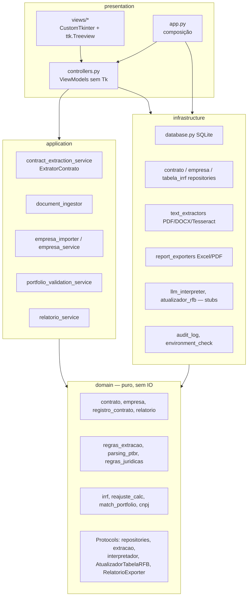
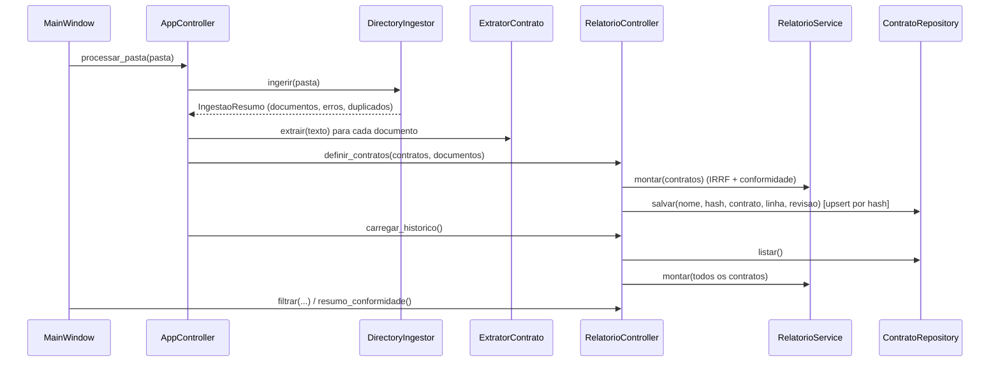

# TRD — Documento de Requisitos Técnicos

| Campo | Valor |
|---|---|
| Documento | TRD — Technical Requirements Document |
| Projeto | Leitor Inteligente de Contratos de Locação (AI Contract Parser) |
| Versão do produto | 0.2.0 |
| Versão do documento | 1.0 |
| Data | 2026-11-24 |
| Status | Rascunho para revisão |

**Documentos relacionados:** [BRD](BRD.md) · [FRD](FRD.md) · [SRS](SRS.md)

> Requisitos técnicos `RT-xx` que o código da v0.2.0 cumpre e que mudanças futuras devem
> preservar, salvo decisão registrada em ADR. Cada RT aponta a evidência no código ou nos
> testes.

---

## 1. Visão técnica

Aplicação Python empacotada como executável Windows *onefile*. O código fica em
`src/contract_parser/` (cerca de 8,1 mil linhas) e a suíte em `tests/` (684 testes coletados).
Ponto de entrada da GUI: `contract_parser.presentation.app:main`. Ponto de entrada da CLI de
ambiente: `contract_parser.infrastructure.environment_check:main`.

## 2. Arquitetura

### 2.1 Camadas e regra de dependência



| ID | Requisito técnico | Evidência |
|---|---|---|
| RT-01 | `domain` não importa `application`, `infrastructure`, `presentation` nem `config`, e não faz IO (arquivo, rede, relógio). | Inspeção dos imports em `domain/*.py`. O relógio é sempre um parâmetro (`reajuste_calc.calcular_proximo_reajuste_anual(…, referencia)`). |
| RT-02 | `application` depende do domínio e de Protocols, nunca de drivers (`sqlite3`, `fitz`, `pytesseract`). Única dependência fora do domínio: `config.settings` em `portfolio_validation_service` (limiar fuzzy padrão). | Inspeção. |
| RT-03 | `infrastructure` implementa os Protocols do domínio e não importa `application` nem `presentation`. | Inspeção; `test_contrato_repository_satisfaz_o_protocol`, `test_fake_satisfaz_protocol_interpretador`. |
| RT-04 | `presentation/controllers.py` não importa `tkinter`/`customtkinter` (testável *headless*). Somente `views/` usa Tk. `app.py` importa a view de forma preguiçosa dentro de `main()`. | `tests/presentation/test_controllers.py` roda sem display. |
| RT-05 | Exceções de driver não chegam à apresentação: `sqlite3.Error` vira `RepositoryError` (infraestrutura) e depois `ControllerError` (apresentação), com mensagem amigável. | `test_excluir_contrato_com_falha_de_banco_vira_controller_error_nao_repository_error`; `test_init_schema_envolve_erro_sqlite_em_repository_error`. |
| RT-06 | A composição de produção fica em `app.build_controller()` (`EmpresaRepository` + `ContratoRepository`) e `AppController` (padrões: `DirectoryIngestor([PdfExtractor(), DocxExtractor()])`, `ExtratorContrato(hoje=date.today)`, `RelatorioService(repo)`, exportadores). Tudo é injetável para os testes. | `presentation/app.py`, `controllers.py::AppController`. |

### 2.2 Fluxo principal (processar pasta)



## 3. Stack tecnológica (de `pyproject.toml`)

| Componente | Pacote / versão mínima | Uso |
|---|---|---|
| Runtime | Python `>=3.11` (CI: 3.13; ruff `target-version = py311`) | — |
| Modelos / validação | `pydantic>=2.7` | `Contrato`, `Empresa`, `TabelaIRRF`, `ResultadoIRRF`, `DocumentoTexto` |
| PDF | `pymupdf>=1.24` (`fitz`) | Texto nativo e renderização de páginas para OCR (sem poppler — adendo ao ADR-001) |
| OCR | `pytesseract>=0.3.10`, `pillow>=10.0` + binário Tesseract (UB-Mannheim) | OCR `por` |
| DOCX | `python-docx>=1.1` | Leitura de contratos |
| Planilhas | `openpyxl>=3.1`, `odfpy>=1.4`, `csv` (stdlib) | Importação de empresas; exportação Excel |
| PDF de saída | `reportlab>=4.2` | Relatório PDF |
| GUI | `customtkinter>=5.2` + `tkinter.ttk.Treeview` | Interface |
| Fuzzy | `rapidfuzz>=3.9` | `token_sort_ratio` + `default_process` |
| Config | `python-dotenv>=1.0` | `.env` |
| Persistência | `sqlite3` (stdlib) | Banco embarcado |
| Dev | `pytest>=8.2`, `pytest-cov>=5.0`, `ruff>=0.17.4,<0.18` | Testes, cobertura, lint |
| Build | `pyinstaller>=6.0` (extra `[build]`) | Executável |

As versões efetivamente instaladas não são fixadas por *lockfile*: só o ruff tem teto de
versão (RT-25).

## 4. Componentes

| Módulo | Responsabilidade |
|---|---|
| `domain/contrato.py` | Agregado `Contrato` e enums (TipoParte, TipoLocacao, ModalidadeGarantia, TipoDespesa, ResponsavelDespesa, OrigemExtracao). |
| `domain/parsing_ptbr.py` | Primitivas puras: moeda pt-BR → `Decimal`; datas numéricas, `mm/aaaa` e por extenso; números por extenso; detecção de CPF/CNPJ. |
| `domain/regras_extracao.py` | Extratores determinísticos por campo; escala de confiança; `ResultadoCampo`. |
| `domain/regras_juridicas.py` | `avaliar_flags()` (Arts. 18/37/35-36, *bis in idem*). |
| `domain/irrf.py` | `TabelaIRRF`, `Faixa`, `ResultadoIRRF`, `calcular_irrf`, `calcular_reducao_lei_15270`, `tabela_irrf_2026`, Protocol `AtualizadorTabelaRFB`. |
| `domain/reajuste_calc.py` | `calcular_proximo_reajuste_anual` (pura, sem relógio). |
| `domain/match_portfolio.py`, `cnpj.py` | Match CNPJ/fuzzy; normalização e DV de CNPJ (DV disponível, não imposto). |
| `domain/relatorio.py` | `LinhaContrato`, `RelatorioContratos`, `ResumoConformidade`, `Relatorio`, Protocol `RelatorioExporter`. |
| `application/contract_extraction_service.py` | Orquestra os extratores, monta a memória de extração, resolve o próximo reajuste e o tipo ambíguo. |
| `application/document_ingestor.py` | Varredura, seleção de backend, deduplicação e erros por arquivo. |
| `application/empresa_importer.py` | Leitura xlsx/csv/ods, detecção de cabeçalho e colunas, importação com progresso e cancelamento. |
| `application/portfolio_validation_service.py`, `relatorio_service.py` | Conformidade; montagem dos Relatórios 01 e 02. |
| `infrastructure/database.py` | Conexão (singleton), PRAGMAs, schema, health check, `RepositoryError`. |
| `infrastructure/*_repository.py` | Persistência SQLite das empresas, contratos e tabela IRRF. |
| `infrastructure/text_extractors.py` | `PdfExtractor`, `DocxExtractor`, `TesseractOcr`. |
| `infrastructure/report_exporters.py` | Formatação pt-BR; `ExcelRelatorioExporter`; `PdfRelatorioExporter`. |
| `infrastructure/audit_log.py` | `registrar_evento()` em `app.log` (nunca lança). |
| `infrastructure/environment_check.py` | CLI PASS/FAIL. |
| `infrastructure/llm_interpreter.py`, `atualizador_rfb.py` | Stubs fail-secure. |
| `presentation/controllers.py` | ViewModels: `EmpresasController`, `ProcessamentoController`, `RelatorioController`, `AppController`. |
| `presentation/views/main_window.py`, `dialogo_importacao_empresas.py` | Widgets CustomTkinter. |

## 5. Persistência

| ID | Requisito técnico | Evidência |
|---|---|---|
| RT-07 | SQLite via `sqlite3` da stdlib; conexão singleton por processo (`get_connection()`); conexão ad-hoc quando um caminho é passado explicitamente; `reset_connection()` idempotente para encerramento e isolamento de testes. | `test_database.py::test_get_connection_e_singleton`, `::test_reset_connection_*` |
| RT-08 | PRAGMAs em toda conexão: `foreign_keys = ON`, `journal_mode = WAL`, `busy_timeout = 5000`; `row_factory = sqlite3.Row`; `check_same_thread = False`. | `test_get_connection_aplica_pragma_*`, `::test_get_connection_usa_row_factory` |
| RT-09 | Schema por `init_schema()`, com `CREATE TABLE IF NOT EXISTS` para `empresas`, `tabela_irrf`, `contratos` e o índice `idx_contratos_processado_em`. **Não há migrações versionadas** (YAGNI, ADR-002): mudança de schema exige plano próprio. Campos compostos ficam em colunas TEXT com JSON. Esquema completo no SRS §3.4. | `test_init_schema_*` |
| RT-10 | `contratos.salvar` faz `INSERT … ON CONFLICT(arquivo_hash) DO UPDATE` sem tocar no `id` (o identificador sobrevive a reprocessamentos). `atualizar_proximo_reajuste` reserializa só `contrato_json` e `linha_json`, preservando a memória de extração. | `test_reprocessar_mesmo_hash_atualiza_em_vez_de_duplicar`, `test_atualizar_proximo_reajuste_preserva_todo_o_resto_do_registro` |
| RT-11 | Caminho do banco: `DATABASE_PATH`, se definido; senão `<raiz>/data/contract_parser.db`, onde `<raiz>` é a pasta do `.exe` (`sys.executable`) quando empacotado ou a raiz do repositório em desenvolvimento. **Nunca** `sys._MEIPASS`. O diretório pai é criado automaticamente. O mesmo vale para `LOG_PATH` / `data/app.log`. | `tests/test_config.py` |

## 6. Motor de extração

### 6.1 Contrato de saída

```
ResultadoCampo[T](valor: T | None, confianca: float, origem: OrigemExtracao = REGRA, detalhe: str | None)
  .nao_encontrado(detalhe)  -> (None, 0.0, NAO_ENCONTRADO, detalhe)
  .resolvido                -> valor is not None and confianca >= LIMIAR_REVISAO
CONF_ALTA = 0.9 · CONF_MEDIA = 0.7 · CONF_BAIXA = 0.45 · LIMIAR_REVISAO = 0.6
revisão(campo) = origem == NAO_ENCONTRADO or confianca < 0.6
```

### 6.2 Princípios de projeto (obrigatórios para novos extratores)

| ID | Princípio | Como se aplica |
|---|---|---|
| RT-12 | **Determinístico primeiro; nunca lançar exceção por texto ausente.** | Toda função `extrair_*` devolve `ResultadoCampo`; texto vazio produz um contrato completo marcado para revisão (`test_extrair_texto_vazio_nao_quebra`). |
| RT-13 | **Ausência confiante × lacuna real.** Se a ausência é o caso normal (carência, fonte do índice, locadores adicionais), devolve `None` ou `[]` com `CONF_ALTA` e sem revisão. Se o campo é esperado e não foi lido, ou foi mencionado sem valor resolvível, devolve `NAO_ENCONTRADO`, que vai para revisão. Booleanos não mencionados (reajuste automático, prorrogação) valem `False` com `CONF_BAIXA`, porque "não mencionado" ≠ "não". | `test_carencia_sem_mencao_e_caso_normal_confiante` × `test_carencia_mencionada_sem_valor_em_meses_dispara_revisao`; `test_sem_carencia_ou_fonte_de_indice_nao_gera_revisao` |
| RT-14 | **Âncora forte antes de padrão genérico**, com confiança decrescente na cascata (ex.: prazo "prazo…N meses" → por extenso → anos → "N meses" solto com `CONF_BAIXA`). | `test_prazo_nao_confunde_com_periodicidade` |
| RT-15 | **Deduplicação por valor, nunca por posição** (`_partes_equivalentes`: documento; senão, nome normalizado). O locador principal é passado explicitamente ao extrator de adicionais. | `test_locadores_adicionais_bloco_duplicado_dedupe_interno` |
| RT-16 | **Calculado ≠ extraído.** Valor derivado por cálculo usa a origem `REGRA_CALCULADA` e `CONF_BAIXA`, nunca sobrescreve um valor lido do texto e mantém a origem após recálculos. | `test_data_explicita_do_texto_prevalece_sobre_o_calculo`, `test_atualizar_proximo_reajuste_mantem_origem_regra_calculada` |
| RT-17 | **Relógio injetado.** `ExtratorContrato(hoje=Callable[[], date] | None)`; sem relógio, o próximo reajuste ausente não é calculado. Só `AppController` (padrão `date.today`) e `RelatorioController.atualizar_proximos_reajustes` (parâmetro `referencia`) leem a data atual. | `test_sem_relogio_injetado_o_calculo_fica_desligado`, `test_app_controller_padrao_ja_nasce_com_relogio_para_proximo_reajuste_calculado` |
| RT-18 | **Regex seguras para pt-BR**: lacunas na mesma linha com `[^\n]{0,N}?` (não usar `[^R\n]` sob `IGNORECASE`); janelas curtas para não colar contexto de outra cláusula; sufixos de rótulo parentéticos `(A/S)` tolerados. | Comentários em `regras_extracao.py`; `test_valor_aluguel_com_r_no_conector`, `test_rotulo_variacoes_genero_plural` |
| RT-19 | **Interpretador opcional e fail-secure.** O orquestrador só consulta o `InterpretadorClausula` para campo ambíguo e trata `NotImplementedError` como revisão. Produção: interpretador não injetado. Recorte máximo de 400 caracteres. | `test_llm_acionado_apenas_quando_regra_nao_resolve`, `test_stub_llm_nao_configurado_degrada_para_revisao` |

### 6.3 Motor de IRRF
- RT-20: `calcular_irrf` é puro, recebe a `TabelaIRRF` por parâmetro, usa somente `Decimal`, quantiza com `ROUND_HALF_UP` e preenche todos os campos de memória de cálculo (BRD RN-07 a RN-12). A tabela valida a topologia (ordena por mínimo; só a última faixa é aberta). Em produção, `RelatorioService` usa `tabela_irrf_2026()`. `TabelaIRRFRepository` (upsert, `get_vigente` por maior vigência) existe e é testado, mas não é usado no fluxo (dívida TD-02).

## 7. Ingestão e OCR

| ID | Requisito técnico | Evidência |
|---|---|---|
| RT-21 | Imports preguiçosos de `fitz`, `pytesseract`, `PIL`, `docx`, `openpyxl`, `reportlab`: construir os objetos não exige as bibliotecas nem o binário. | `test_tesseract_ocr_construivel_sem_binario` |
| RT-22 | Roteamento: texto nativo com ≥ 20 caracteres (`LIMIAR_TEXTO_NATIVO`) usa o nativo; senão OCR a 300 DPI (`DPI_OCR`) via `page.get_pixmap`; confiança média < 60 (`LIMIAR_CONFIANCA_OCR`) marca `baixa_confianca`. Hash SHA-256 do binário calculado antes de qualquer parsing. | `test_pdf_roteia_para_ocr_quando_texto_abaixo_do_limiar`, `test_pdf_hash_depende_do_conteudo` |
| RT-23 | Resolução do Tesseract: (1) `TESSERACT_CMD`; (2) no `.exe` congelado, `<_MEIPASS>/tesseract/tesseract.exe` com `TESSDATA_PREFIX=<_MEIPASS>/tesseract/tessdata`, via variável de ambiente e **não** via `--tessdata-dir` em `config` (no Windows, `pytesseract` mantém as aspas e corrompe o caminho); (3) `PATH`. | `test_reconhecer_usa_embutido_quando_congelado_e_sem_tesseract_cmd`, `test_reconhecer_prioriza_tesseract_cmd_do_usuario_mesmo_congelado` |

## 8. Tratamento de erros e resiliência

| Situação | Comportamento técnico |
|---|---|
| Arquivo de contrato inválido | `DocumentoTexto.erro` preenchido → `ErroArquivo` no resumo. Exceções inesperadas são capturadas por arquivo (`noqa: BLE001` documentado). |
| Linha de planilha inválida | `ErroLinha(n_linha, motivo)` com mensagem pydantic traduzida (`validation_messages.formatar_erro_validacao`). |
| Falha de `sqlite3` | `RepositoryError` com contexto → `ControllerError(_MSG_BANCO)`. |
| Falha ao gravar um contrato do lote | O item fica com `id = None`, o motivo vai para `erros_persistencia()` e o Painel continua. |
| Falha ao listar ou desserializar o histórico | `carregar_historico()` registra no `app.log` e retorna sem lançar. |
| Health check | `check_health()` retorna `HealthResult(ok, detalhe)`, nunca lança. |
| Log de auditoria | `registrar_evento()` engole qualquer exceção (falhar ao auditar não derruba a UI). Sem rotação (YAGNI). |
| Exportação | `OSError` → `ControllerError("Falha ao gravar o arquivo de saída: …")`; formato desconhecido → `ValueError`. |
| PDF de saída | Larguras de coluna fixas somando 785 pt (A4 paisagem − margens de 28 pt), com `assert` em tempo de import; sem isso o reportlab descarta colunas silenciosamente (bug corrigido na 0.2.0). |

## 9. Configuração

| Variável | Padrão | Uso | Lida em |
|---|---|---|---|
| `DATABASE_PATH` | `<raiz>/data/contract_parser.db` | Arquivo SQLite | `config.Settings` |
| `LOG_PATH` | `<raiz>/data/app.log` | Log de auditoria | `config.Settings` |
| `TESSERACT_CMD` | vazio | Binário do Tesseract (prioridade sobre o embutido) | `TesseractOcr`, `environment_check` |
| `OCR_LANG` | `por` | Idioma do OCR | `TesseractOcr`, `environment_check` |
| `FUZZY_MATCH_THRESHOLD` | `85` | Limiar do match fuzzy (0–100, inclusivo) | `PortfolioValidationService` |
| `LLM_PROVIDER`, `LLM_API_KEY` | vazio | **Sem efeito em produção**: carregados em `Settings`, mas não usados na composição | — |
| `TESSERACT_BUILD_DIR` | `C:\Program Files\Tesseract-OCR` | Origem do Tesseract **na máquina de build** | `contract_parser.spec` |
| `CONTRATOS_REAIS_DIR` | não definido | Pasta local de PDFs reais para o harness opcional (nunca versionada; ausente → *skip*) | `tests/application/test_harness_contratos_reais.py` |

`.env` é carregado por `python-dotenv` na importação de `config.py`; `.env.example` é o
modelo versionado. `Settings` é imutável (`frozen=True`).

## 10. Build e empacotamento

| ID | Requisito técnico |
|---|---|
| RT-24 | `build.bat` (raiz do repositório): cria ou reutiliza `.venv`, roda `pip install -e ".[build]"` e `pyinstaller contract_parser.spec --clean --noconfirm`. Saída: `dist\ContractParser.exe`. Cada passo aborta com mensagem em caso de erro. |
| RT-25 | `contract_parser.spec`: script de entrada `src/contract_parser/presentation/app.py` (`pathex=["src"]`); `EXE` *onefile* (`a.binaries` + `a.datas` no EXE), `console=False`, `upx=True`, nome `ContractParser`. Inclui os dados do `customtkinter` (`collect_data_files`), `tesseract.exe` + todas as `*.dll` do diretório do Tesseract em `tesseract/` e **somente** `tessdata/por.traineddata`. Sem os executáveis auxiliares de treino. Interrompe o build com mensagem clara se o Tesseract, o `tesseract.exe` ou o `por.traineddata` não forem encontrados. |
| RT-26 | Verificação pós-build: conferir que a data/hora de modificação de `dist\ContractParser.exe` é posterior ao início do build (o PyInstaller pode deixar um `.exe` antigo se falhar no meio) e fazer um teste de fumaça abrindo o `.exe`. Procedimento manual, não automatizado. |
| RT-27 | Distribuição: o `.exe` sozinho basta; os dados do usuário ficam em `data/` ao lado dele. Para backup ou migração, copiar a pasta inteira. Licença do Tesseract: Apache 2.0 (registrada no README). |

## 11. CI/CD

| ID | Requisito técnico |
|---|---|
| RT-28 | `.github/workflows/ci.yml`: dispara em `push` e `pull_request` na `main`; `permissions: contents: read`; `runs-on: windows-latest`; `actions/setup-python@v5` com Python `3.13` e cache de pip; instala com `pip install -e ".[dev]"`; executa `ruff check src tests` e `pytest -q -m "not integration"`. |
| RT-29 | O ruff fica fixado em `>=0.17.4,<0.18` para o lint não mudar sozinho (um upgrade para 0.17 quebrou o CI por `RUF100`; ver CHANGELOG). |
| RT-30 | Não há pipeline de release automatizado: o `.exe` é gerado localmente (`build.bat`) e publicado manualmente em GitHub Releases. Não verificado neste documento. |

## 12. Estratégia de testes

| Nível | Onde | Técnica |
|---|---|---|
| Unitário (domínio) | `tests/domain/` | Funções puras; tabelas parametrizadas; valores fiscais recompostos de forma independente no teste. |
| Integração (application/infra) | `tests/application/`, `tests/infrastructure/` | Fakes de repositório, extrator, OCR e interpretador (`tests/support/fakes.py`); SQLite real em `:memory:` e em arquivo temporário; documentos gerados em tempo de teste (`tests/support/document_builders.py`, `fixture_builders.py`). |
| E2E *headless* | `tests/presentation/` | Controllers e pipeline cross-fase até a exportação e releitura do `.xlsx`; *smoke* de import das views. |
| Fixtures | `tests/fixtures/*.txt`, `*.csv` | Contratos e planilhas **sintéticos** (matriz PF/PJ, residencial/comercial, abusivo, reajuste vedado, rótulo parentético, tipo ambíguo). |
| `integration` (marker) | 3 testes: OCR real ×2 e LLM real | Exigem recurso externo; *skip* automático; **excluídos do CI**. |
| Harness de contratos reais | `test_harness_contratos_reais.py` | Opt-in local via `CONTRATOS_REAIS_DIR`; afere invariantes estruturais; *skip* sem a variável. |

- RT-31: `pytest` com `pythonpath = ["src"]` e `addopts = "-ra --cov=contract_parser --cov-report=term-missing"`. Nenhum limiar mínimo de cobertura é imposto.
- RT-32: novas regras de extração entram com teste antes do código (TDD), cobrindo o caso positivo, a ausência confiante e a lacuna real.
- Falha conhecida: `test_ocr_real_tesseract` passa isolado e falha na suíte inteira por vazamento de estado entre módulos (provável interação com o estado global de `pytesseract.pytesseract.tesseract_cmd` / `TESSDATA_PREFIX` alterado em outros testes; **causa não confirmada**). Está fora do CI por ser `integration`.

## 13. Segurança e privacidade (restrições técnicas)

- RT-33: nenhum cliente HTTP nem SDK de LLM é importado no código de produção. Os stubs (`StubInterpretadorLLM`, `StubAtualizadorTabelaRFB`) lançam `NotImplementedError` explícito e documentam o ponto de extensão.
- RT-34: dados reais fora do Git (`.gitignore`); fixtures apenas sintéticas; `test_extracao_reais_anonimizadas.py` reproduz layouts reais com fixtures que o próprio módulo declara como 100% anonimizadas (dados fictícios). Essa declaração não foi auditada linha a linha neste documento.
- RT-35: sem segredos no repositório; `.env` ignorado.
- RT-36: aplicação local sem autenticação. O arquivo `.db` não é criptografado; a proteção depende das permissões NTFS da pasta. Decisão implícita de escopo (usuário único), não um controle implementado.
- O CNPJ não é validado por dígito verificador (`validar_dv_cnpj` existe, mas não é chamado por padrão) para tolerar OCR e bases legadas.

## 14. Dívida técnica e limitações conhecidas

| ID | Item | Local | Referência no BRD |
|---|---|---|---|
| TD-01 | ✅ Resolvida (2026-11-24): `calcular_irrf(tipo_locatario=...)`; o locatário sem tipo é resolvido pelo casamento com o portfólio, reaproveitando a única leitura de `montar()`. | `domain/irrf.py`; `application/relatorio_service.py` | L-01 |
| TD-02 | `TabelaIRRFRepository` e o fluxo de revalidação RFB não estão ligados à composição; a tabela vem da factory em código; não há aviso de validade. | `relatorio_service.py`, `infrastructure/tabela_irrf_repository.py` | L-02 |
| TD-03 | Flags jurídicas e vários campos extraídos não chegam ao Painel nem às exportações. | `controllers.py::LinhaPainel`, `report_exporters.CABECALHOS_CONTRATOS` | L-03 |
| TD-04 | `EmpresaStatus` (método/score por empresa) não é exposto; empresas inativas entram no cruzamento. | `portfolio_validation_service.py` | L-04 |
| TD-05 | `DocumentoTexto.baixa_confianca` (OCR) não é consumido pela extração ou revisão. | `controllers.py::ProcessamentoController` | L-05 |
| TD-06 | `contratos.arquivo_ausente` nunca é definido como verdadeiro (detecção de arquivo removido não implementada). | `contrato_repository.py` | — |
| TD-07 | Processamento de contratos síncrono na thread da UI. | `views/main_window.py::_processar_e_exibir` | L-09 |
| TD-08 | Varredura de pasta não recursiva. | `document_ingestor._listar_arquivos` | — |
| TD-09 | Sem migrações de schema versionadas. | `database.init_schema` | — |
| TD-10 | Mensagem final do `build.bat` desatualizada: diz que o Tesseract **não** é embutido e pede `TESSERACT_CMD`, o que contradiz o `.spec` e o README. | `build.bat` | — |
| TD-11 | Comentário no `PdfRelatorioExporter.exportar` fala em "13 colunas"; são 15. | `report_exporters.py` | — |
| TD-12 | `test_ocr_real_tesseract` instável na suíte completa. | `tests/infrastructure/test_text_extractors.py` | — |
| TD-13 | `LinhaContrato` é persistida em `linha_json`, mas o Painel recalcula as linhas a partir de `contrato_json` a cada carga (`linha_json` é redundante para leitura). | `controllers.carregar_historico` | — |

## 15. Histórico de decisões (ADRs) e divergências reconciliadas

| ADR / documento | Decisão original | Estado na v0.2.0 |
|---|---|---|
| ADR-001 D1 | Extração híbrida: regras + LLM para cláusulas ambíguas. | Regras determinísticas apenas. O LLM existe só como Protocol e stub fail-secure, adiado por LGPD. |
| ADR-001 D2 | Sem Docker (CA-02 deferido). | Mantido. |
| ADR-001 D2-bis | MongoDB Community local. | **Substituído pelo ADR-002**: SQLite embarcado. O ADR-002 previa 2 tabelas; hoje há 3 (`contratos` foi adicionada com a persistência do histórico) + 1 índice. |
| ADR-001 D3/D4/D5 | CustomTkinter; CNPJ + fuzzy; tabela IRRF versionada e *data-driven* no banco. | D3 e D4 mantidos (o Painel migrou para `ttk.Treeview`). D5 parcial: a tabela é versionada e tem proveniência, mas a fonte usada é a factory em código (TD-02). |
| ADR-001 adendo | OCR com PyMuPDF, sem `pdf2image`/poppler. | Mantido. |
| ADR-003 | Redutor da Lei nº 15.270/2025 ativo; desconto simplificado fora de escopo; CA-03 = R$ 153,38. | Redutor mantido. **§3/§4 revistos pelo ADR-004.** |
| ADR-004 | Desconto simplificado de R$ 607,20 incondicional para locador PF; redutor sobre o bruto; CA-03 = R$ 0,00. | Vigente no código e nos testes. |
| Checklist de aceite (Fase 8) | CA-03 = R$ 466,27; "redutor desligado". | Superado pelos ADR-003/004. |
| Requisitos §6 | "OCR de baixa confiança → revisão"; "tabela desatualizada → última persistida + aviso de validade"; operador "revalida tabela IRRF". | Não implementados no fluxo (TD-05, TD-02). |
| Plano de importação ODS | Múltiplas abas fora de escopo. | Implementado depois (seleção de aba no diálogo, plano de correção da importação). |

Os ADRs e planos ficam no repositório de specs do projeto (`~/.claude/specs/`). Os links do
`README.md` ainda apontam para o caminho antigo `.agent/specs/`, removido da árvore de
trabalho.
